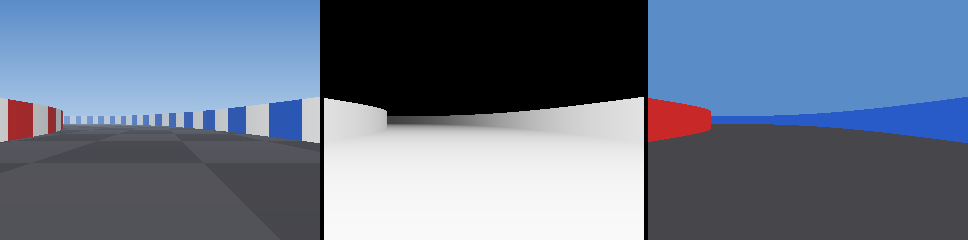

# Raycer

Raycer is a pseudo-3D racing game with column raycasting that doubles as a headless, CPU-only
machine learning research environment in the spirit of ViZDoom, with pixel-aligned RGB, depth
and semantic-label buffers.



## Installation

```bash
uv add raycer
uv add "raycer[human]"   # optional: pygame viewer for `raycer play` and render_mode="human"
```

Raycer needs Python 3.12 or newer. The only runtime dependencies are numpy and gymnasium; pygame
is pulled in only by the `human` extra.

## Quickstart

Gymnasium layer:

<!-- test -->
```python
import gymnasium
import raycer  # noqa: F401  (registers the Raycer/* IDs)

env = gymnasium.make("Raycer/Oval-v0", depth=True, labels=True)
obs, info = env.reset(seed=0)
for _ in range(100):
    obs, reward, terminated, truncated, info = env.step(env.action_space.sample())
    if terminated or truncated:
        break
```

Low-level `raycer.Game` layer:

<!-- test -->
```python
import raycer

game = raycer.Game()
game.set_scenario("oval-v0")
game.init()
game.new_episode(seed=0)
reward = game.make_action(1)  # discrete action 1 = throttle, or [steer, throttle]
state = game.get_state()  # screen_buffer (72, 96, 3) uint8, game_variables (8,) float32
```

More in [`examples/`](examples/README.md) and [`docs/`](docs/api.md).

## Scenarios

| Name | Gym ID | Track | Laps | Max steps |
| --- | --- | --- | --- | --- |
| `oval-v0` | `Raycer/Oval-v0` | builtin `oval` | 1 | 3000 |
| `kidney-v0` | `Raycer/Kidney-v0` | builtin `kidney` | 1 | 3000 |
| `technical-v0` | `Raycer/Technical-v0` | builtin `technical` (with obstacles) | 1 | 4000 |
| `proc-train-v0` | `Raycer/ProcTrain-v0` | procedural `medium`, split train | 1 | 4000 |
| `proc-test-v0` | `Raycer/ProcTest-v0` | procedural `medium`, split test | 1 | 4000 |
| `time-trial-v0` | `Raycer/TimeTrial-v0` | builtin `oval`, `w_time = 0.05` | 3 | 9000 |

Every ID also exists as a `-Continuous-v0` variant with the continuous action space, for example
`Raycer/Oval-Continuous-v0`. See [docs/scenarios.md](docs/scenarios.md).

## Observations

The observation is a `spaces.Dict`. Image keys exist only when their buffer is enabled
(`screen=True`, `depth=False`, `labels=False` by default); `gamevariables` always exists.
Images are HWC, default 96x72.

| Key | Space |
| --- | --- |
| `screen` | `Box(0, 255, (H, W, 3), uint8)` |
| `depth` | `Box(0, 255, (H, W, 1), uint8)`, `round(255 * d / max_view_distance)`, near is dark |
| `labels` | `Box(0, 5, (H, W, 1), uint8)`, label IDs 0 to 5 |
| `gamevariables` | `Box(-inf, inf, (8,), float32)`, see `raycer.GAME_VARIABLES` |

Labels, palette, game variables and depth details: [docs/observations.md](docs/observations.md).

## Actions

Discrete actions are `Discrete(9)`, exported as `raycer.DISCRETE_ACTIONS` with values
`[steer, throttle]`. **steer > 0 means left**; throttle > 0 accelerates, throttle < 0 brakes.

| Index | Meaning | steer | throttle |
| --- | --- | --- | --- |
| 0 | idle | 0 | 0 |
| 1 | throttle | 0 | +1 |
| 2 | brake | 0 | -1 |
| 3 | left | +1 | 0 |
| 4 | right | -1 | 0 |
| 5 | throttle + left | +1 | +1 |
| 6 | throttle + right | -1 | +1 |
| 7 | brake + left | +1 | -1 |
| 8 | brake + right | -1 | -1 |

The continuous action space (`action_type="continuous"` or the `-Continuous-v0` IDs) is
`Box([-1, -1], [1, 1], (2,), float32)` holding `[steer, throttle]`; values outside are clipped.

## Reward

Per physics tick:

```
r_t = w_progress * ds_t - w_time - w_collision * c_t - w_wrongway * ww_t + w_lap * L_t
```

`ds_t` is the progress along the centre line in metres, `c_t` is 1 on a new collision, `ww_t` is
1 while driving the wrong way and `L_t` is 1 when a lap was just completed. An env step returns
the sum over its `frame_skip` (default 4) ticks. Default weights: `w_progress=0.1`,
`w_time=0.01`, `w_collision=1.0`, `w_wrongway=0.05`, `w_lap=10.0`. Override them with the
`[reward]` table of a TOML config, the env kwarg `reward=` or `Game.set_reward_config`.
`info["reward_components"]` holds the weighted terms.

## CLI

```bash
raycer --version
raycer list
raycer benchmark --scenario technical-v0 --steps 5000 --width 96 --height 72 --buffers screen,depth,labels --seed 0 --json --min-sps 250
raycer render-sample --scenario oval-v0 --seed 0 --steps 60 --width 320 --height 240 --out samples
raycer play --scenario oval-v0 --seed 0 --width 320 --height 240 --depth --labels --continuous --record recordings
raycer play --replay recordings/oval-v0_snone_20260101-120000.npz
```

`raycer play` needs the `human` extra. Keys: arrows or WASD to drive, R reset, P pause, Tab
switches the view, F12 screenshot, Esc quits. See [docs/benchmark.md](docs/benchmark.md) and
[docs/recording.md](docs/recording.md).

## For ViZDoom users

| ViZDoom | Raycer |
| --- | --- |
| `vizdoom.DoomGame` | `raycer.Game` |
| `set_doom_scenario_path` / `load_config("x.cfg")` | `set_scenario("oval-v0")` / `load_config("x.toml")` |
| `set_screen_resolution(ScreenResolution.RES_...)` | `set_screen_resolution(width, height)` |
| `set_depth_buffer_enabled` / `set_labels_buffer_enabled` | same names |
| `set_episode_timeout` | same name (in env steps) |
| `set_seed` | same name |
| `init` / `new_episode` / `close` | same names |
| `make_action(action, tics)` | `make_action(action)`, ticks via `set_frame_skip` |
| `get_state().screen_buffer` / `depth_buffer` / `labels_buffer` | same names |
| `get_state().game_variables` | same name, names in `get_game_variable_names()` |
| `is_episode_finished` / `get_total_reward` / `get_episode_time` | same names |

Differences: configs are TOML instead of `.cfg`, buffers are HWC (`(H, W, 3)`) instead of CHW,
`make_action` accepts a discrete index or `[steer, throttle]` and there are no Doom buttons.

## Citing and license

If you use Raycer in research, please cite it with the metadata in
[`CITATION.cff`](CITATION.cff). Raycer is released under the MIT license, see
[`LICENSE`](LICENSE).
