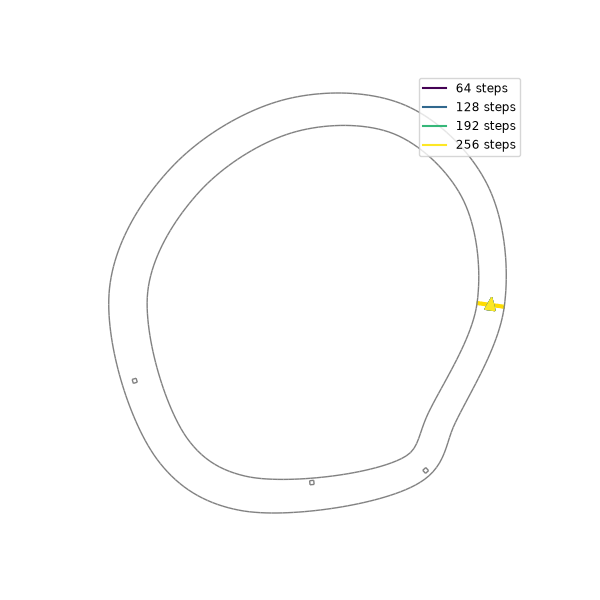

# Trajectories

`raycer.trajectory` draws car poses `(x, y, heading)`, for example the `info["pose"]` values
of an episode, as a top-down plot or an animated GIF. It needs matplotlib from the `plot` extra:

```bash
uv add "raycer[plot] @ git+https://github.com/JulianErt/Raycer"
```

Without it, `import raycer.trajectory` raises an `ImportError` with this install hint;
`import raycer` never imports matplotlib.



## Functions

- `plot_trajectories(track, paths, out)` writes a static plot. `out` must end in `.png` or
  `.pdf`.
- `animate_trajectories(track, paths, out, fps=30)` writes a GIF with one frame per pose of the
  longest path. Frame `i` shows each path up to pose `min(i, T - 1)`, so shorter paths stay at
  their last pose, and a triangle arrow at each tip points along the heading. `out` must end in
  `.gif`.

`track` is a `raycer.track.Track`, for example `env.unwrapped.game.get_track()`. `paths` maps a
label to an array-like of shape `(T, 3)` with `T >= 1`; any other shape or suffix raises
`ValueError`.

Both functions draw the walls grey and the finish line as a filled yellow polygon. Each label
gets one line; its colour is sampled evenly from the `viridis` colormap in insertion order, so
the first label is dark purple and the last label yellow. A legend lists every label.

## Finished paths

A path counts as finished when replaying its poses through `ProgressTracker` (reset on the
first pose, then one update per later pose with speed 0 and no collision) gives `lap >= 1`,
the same rule the env uses for `info["is_success"]`. In the static plot, a path that did not
finish ends with an × marker in its colour at its last pose.

## Example

`examples/trajectories.py` drives every Stable-Baselines3 checkpoint in a folder greedily for
one episode on a `Raycer/ProcTest-v0` track and writes `runs/trajectories.png` and
`runs/trajectories.gif`. With `--train-steps N` it first trains PPO on `Raycer/ProcTrain-v0`
and saves four checkpoints:

```bash
uv sync --group train --extra plot
uv run examples/trajectories.py --train-steps 20000 --obs rgb --track 0
```

`--checkpoints DIR` (default `runs/checkpoints`) selects the checkpoint folder, `--track N` the
track seed `SPLITS["test"].start + N`, `--steps N` caps each episode and `--out DIR` sets the
output folder. The GIF above comes from a short `--train-steps 256 --steps 300` run.
